# 🎯 My Quiz Game

> **Codyssey E1-2 · 컴퓨터에게 명1령 내리는 말(파이썬) 처음 배우기**  
> 터미널에서 메뉴를 선택해 퀴즈를 풀고, 추가하고, 최고 점수를 기록하는 Python 콘솔 퀴즈 게임입니다. 퀴즈와 점수는 `state.json`에 저장되어 프로그램을 다시 실행해도 유지되며, 전 과정을 Git 기능 단위 커밋과 브랜치로 관리했습니다.

<p align="center">
  
  
  
  
  
</p>

**GitHub 저장소:** https://github.com/qjskffj-code/codyssey_E1-2

---

## Summary

| 구분 | 내용 |
|---|---|
| 해결한 문제 | 문법 조각이 아닌, 입력부터 저장까지 동작하는 프로그램 하나를 처음부터 끝까지 완성하기 |
| 구현 형태 | Python 대화형 CLI 퀴즈 게임 |
| 퀴즈 주제 | E1-2 미션 핵심 개념 (Python 기초 · 클래스 · 파일 입출력 · Git) |
| 핵심 흐름 | 데이터 불러오기 → 메뉴 반복 → 풀기 / 추가 / 목록 / 점수 / 삭제 → 저장 후 종료 |
| 클래스 구조 | `Quiz`(문제 한 개) + `QuizGame`(게임 전체 관리) |
| 기본 데이터 | 직접 작성한 퀴즈 **10개** (요구 기준 5개 이상) |
| 데이터 영속성 | 프로젝트 루트 `state.json` (UTF-8) 자동 저장 및 불러오기 |
| 안정성 | 잘못된 입력 재요청, `Ctrl+C`/EOF 안전 종료, 손상 파일 백업 후 자동 복구 |
| 보너스 | 퀴즈 삭제 (번호 선택, `0` 취소, `y/n` 확인 후 파일 반영) |
| Git | 의미 있는 커밋 10개 이상, `feature/play-quiz` 브랜치 생성 및 `--no-ff` 병합, clone/pull 실습 |
| 외부 의존성 | 없음 (표준 라이브러리 `json`, `pathlib`, `shutil`, `datetime`만 사용) |

### 바로가기

- [프로젝트 개요](#overview)
- [문제와 해결 방법](#problem--solution)
- [설계: 클래스와 책임 분리](#design)
- [처리 흐름](#architecture)
- [핵심 기능](#features)
- [입력 검증과 경계 케이스](#input-validation)
- [실행 화면](#screenshots)
- [개발 환경](#development-environment)
- [실행 방법](#how-to-run)
- [데이터 파일 (state.json)](#data-file-statejson)
- [종료·오류·복구 시나리오](#error-handling--recovery)
- [테스트](#testing)
- [Git 작업 이력과 규칙](#git-workflow)
- [유지보수 가이드](#maintenance-guide)
- [공식 미션 요구사항](#공식-미션-요구사항-체크리스트)
- [오류 해결 기록](#troubleshooting)
- [배운 점](#what-i-learned)

---

# Overview

프로그래밍 언어를 배우는 가장 확실한 방법은 동작하는 프로그램을 처음부터 끝까지 직접 만들어 보는 것입니다. 이 프로젝트는 "문법을 아는 것"과 "그 문법으로 하나의 프로그램을 완성하는 것"의 차이를 직접 경험하기 위해, 터미널에서 동작하는 퀴즈 게임을 구현했습니다.

사용자는 메뉴에서 번호를 선택해 퀴즈를 풀고, 새 퀴즈를 등록하거나 삭제하고, 목록과 최고 점수를 확인할 수 있습니다. 프로그램은 실행 시 `state.json`을 읽어 이전 상태를 복원하고, 퀴즈 추가·삭제·풀이 완료·종료 시점마다 파일에 저장합니다.

## 퀴즈 주제와 선정 이유

**주제: E1-2 미션 핵심 개념 (Python 기초, 클래스, 파일 입출력, Git)**

E1-2 미션에서 배우는 Python 기초, 클래스, 파일 입출력, Git 개념을 퀴즈로 만들어, 게임을 만들면서 동시에 핵심 개념을 복습하고 시험에 대비하기 위해 선택했습니다. 만든 프로그램이 곧 학습 도구가 되도록 했습니다.

## What I Built

1. **Interactive CLI Menu** · `print()`/`input()` 기반 메뉴, `while` 반복으로 종료 전까지 재표시
2. **Robust Input Handling** · 공백 제거, 빈 입력, 문자, 음수·범위 밖 숫자를 모두 재입력 처리
3. **Class-based Design** · `Quiz`(데이터·채점)와 `QuizGame`(진행·저장)으로 책임 분리
4. **Data Persistence** · `state.json`에 UTF-8 JSON으로 저장, 손상 시 백업 후 기본값 복구
5. **Bonus: Quiz Delete** · 목록에서 번호로 골라 확인 후 삭제, 즉시 저장
6. **Git Workflow** · 기능 단위 커밋, 브랜치 개발 후 병합, clone/pull 실습

## Tech / Tools

| 영역 | 사용 기술 | 역할 |
|---|---|---|
| Language | Python 3.14.5 | 전체 프로그램 구현 (요구 조건: 3.10 이상) |
| Standard Library | `json` | 퀴즈·점수 직렬화 및 역직렬화 |
| Standard Library | `pathlib` | 실행 위치와 무관하게 프로젝트 루트의 `state.json` 경로 계산 |
| Standard Library | `shutil`, `datetime` | 손상된 저장 파일을 시간이 붙은 백업 파일로 복사 |
| Data | JSON (UTF-8) | 데이터 영속성 |
| Version Control | Git / GitHub | 기능 단위 커밋, 브랜치, 병합, 원격 저장소 관리 |
| Editor | Visual Studio Code | 개발, 실행, 터미널 작업 |

---

# Problem & Solution

## Problem

- 사용자는 숫자 대신 글자를 입력하거나, 빈 Enter를 누르거나, `Ctrl+C`로 프로그램을 끊을 수 있습니다.
- 프로그램이 종료되면 메모리에 있던 퀴즈와 점수가 모두 사라집니다.
- 저장 파일이 없거나(첫 실행) 내용이 손상되면 프로그램이 시작조차 못 할 수 있습니다.
- 모든 코드를 한 곳에 작성하면 기능을 추가할 때마다 구조가 복잡해집니다.
- 함수마다 퀴즈 목록과 점수를 주고받으면 값 갱신을 놓치기 쉽습니다.

## Solution

| 문제 | 해결 방법 |
|---|---|
| 잘못된 입력 | `strip()` 후 빈 값·`ValueError`·범위 검사, 실패 시 안내 후 재입력 |
| 비정상 종료 | `KeyboardInterrupt`, `EOFError`를 잡아 저장 후 안전 종료 |
| 데이터 소실 | 추가·풀이 완료·종료 시 `state.json`에 자동 저장 |
| 첫 실행 / 파일 손상 | 파일 없음 → 기본 퀴즈, 손상 → 원인 출력·백업 후 기본 퀴즈로 복구 |
| 저장 형식 검증 | 선택지 4개, 정답 1~4가 아니면 손상 파일로 간주 |
| 코드 복잡도 | `Quiz` / `QuizGame` 두 클래스로 책임 분리, 기능별 메서드 분리 |
| 상태 전달 누락 | 퀴즈 목록과 최고 점수를 `QuizGame`의 속성(`self`)으로 관리 |

---

# Design

## 클래스별 책임

| 클래스 | 파일 | 책임 (하는 일) | 책임이 아닌 것 | 비유 |
|---|---|---|---|---|
| `Quiz` | `quiz.py` | 문제 1개의 데이터(`question`, `choices`, `answer`) 보관, 화면 출력(`display`), 정답 판정(`is_correct`), 저장용 dict 변환(`to_dict`) | 사용자 입력 받기, 파일 읽기/쓰기, 점수 관리 | 문제 카드 한 장 |
| `QuizGame` | `quiz_game.py` | 퀴즈 목록·최고 점수 보관, 메뉴 표시와 분기, 입력 검증, 게임 진행·채점 집계, 퀴즈 추가·삭제, `state.json` 저장/불러오기/복구 | 문제 하나의 내용과 정답 규칙 | 퀴즈쇼 진행자 |
| (함수) `get_default_quizzes` | `quiz_data.py` | 기본 퀴즈 10개 정의 | 게임 로직 | 기본 문제집 |
| (함수) `main` | `main.py` | `QuizGame` 생성 후 `run()` 호출 | 그 외 전부 | 전원 버튼 |

`Quiz`는 "문제 자체"만 알고, `QuizGame`은 "문제들을 어떻게 진행하고 저장할지"만 압니다. 그래서 문제 형식을 바꿔도 `QuizGame`의 진행 로직은 거의 바뀌지 않고, 저장 방식을 바꿔도 `Quiz`는 그대로입니다.

## 왜 클래스를 사용했나 (객체지향의 장점)

| 장점 | 이 프로젝트에서의 효과 |
|---|---|
| **데이터와 동작을 한 곳에** | 문제·선택지·정답과 "정답 확인"이 `Quiz` 안에 함께 있어, 채점 규칙을 찾을 때 한 파일만 보면 됩니다. |
| **상태 공유가 쉬움** | 함수 구조에서는 `best_score = update_best_score(score, best_score)`처럼 값을 주고받아야 했지만, `QuizGame`에서는 `self.best_score`를 모든 메서드가 함께 씁니다. 갱신 누락 실수가 사라졌습니다. |
| **재사용** | `Quiz` 틀 하나로 기본 퀴즈 10개, 사용자가 추가한 퀴즈, 파일에서 불러온 퀴즈를 모두 같은 방식으로 만듭니다. |
| **변경 범위 축소** | 기능별 메서드로 나뉘어 있어 "점수 계산만 바꾸기" 같은 수정이 다른 기능에 영향을 주지 않습니다. |
| **테스트 용이성** | `QuizGame(state_file=...)`로 저장 경로를 바꿔 끼울 수 있어, 실제 데이터를 건드리지 않고 테스트할 수 있습니다. |

## 로직 분리 기준

`QuizGame` 안의 메서드는 다음 4개 계층으로 나뉘며, **위 계층만 아래 계층을 호출**합니다.

| 계층 | 메서드 | 경계 규칙 |
|---|---|---|
| ① 흐름 제어 | `run()` | 불러오기 → 메뉴 반복 → 종료만 담당. 직접 계산하거나 파일을 열지 않음 |
| ② 기능(게임 진행) | `play()`, `add_quiz()`, `show_quiz_list()`, `delete_quiz()`, `show_best_score()`, `update_best_score()` | 사용자 입력은 반드시 ③을 통해서만 받고, 저장은 반드시 ④를 통해서만 수행 |
| ③ 입력 검증 | `ask_number()`, `ask_text()` | `input()`을 호출하는 유일한 곳. **검증을 통과한 값만** 돌려주므로 ②는 값이 올바르다고 믿고 사용 |
| ④ 데이터 입출력 | `load()`, `save()`, `backup_broken_file()`, `reset_to_default()` | `open()`과 `json`을 쓰는 유일한 곳. 파일 오류는 이 계층 안에서 처리하고 밖으로 던지지 않음 |

- **입력 검증의 경계:** 키보드에서 들어온 "글자"를 "믿을 수 있는 숫자/문장"으로 바꾸는 곳까지가 ③입니다.
- **데이터 IO의 경계:** 파일의 "JSON 글자"와 메모리의 "`Quiz` 객체 목록" 사이 변환까지가 ④입니다. 파일에서 읽은 값도 사용자 입력처럼 검증(선택지 4개, 정답 1~4)한 뒤에만 객체로 만듭니다.

---

# Architecture

## 전체 실행 흐름

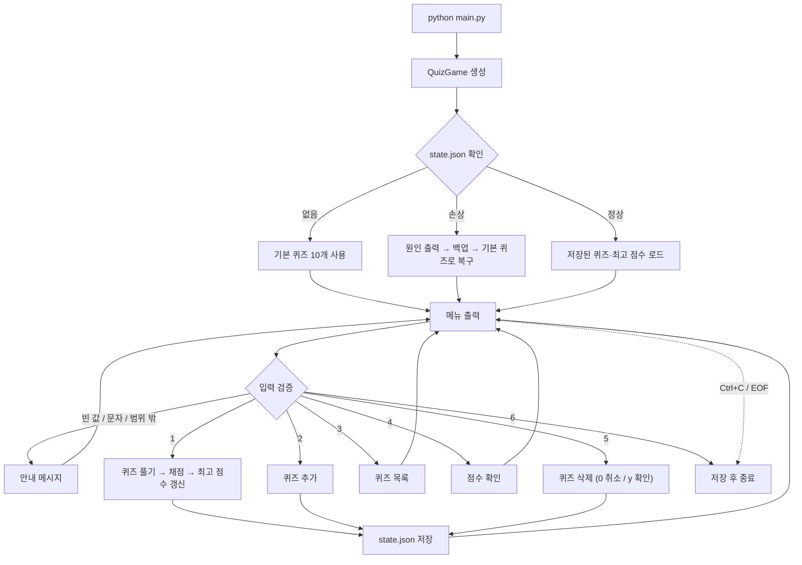

## state.json 읽기 → 처리 → 쓰기 순서

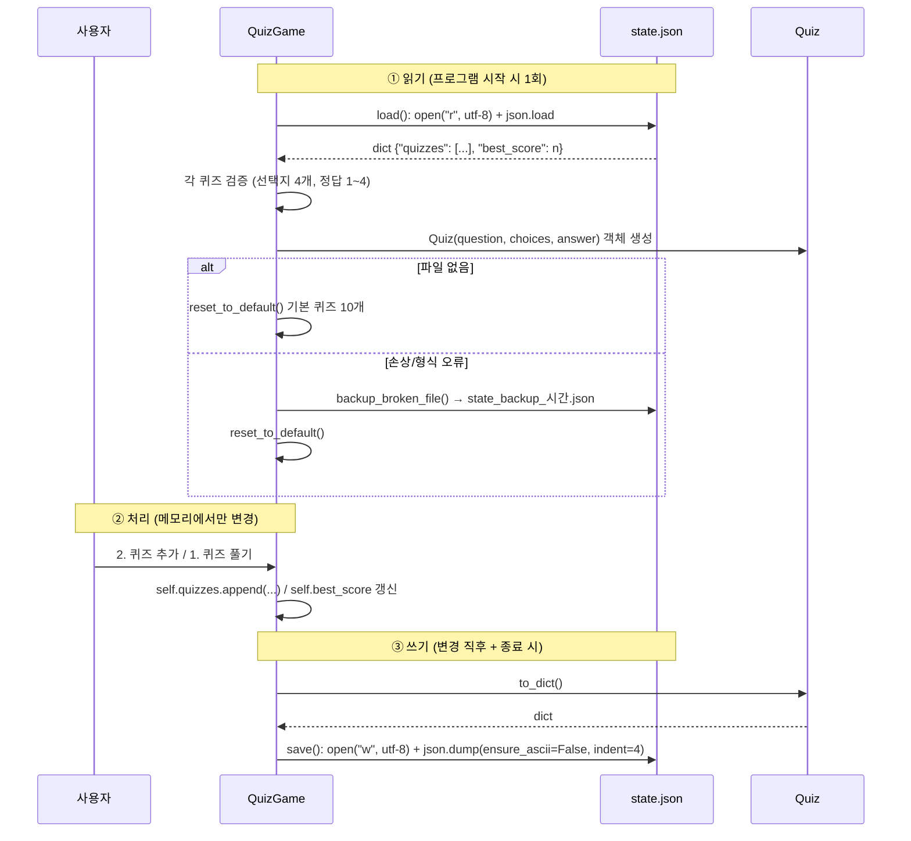

## 클래스 다이어그램

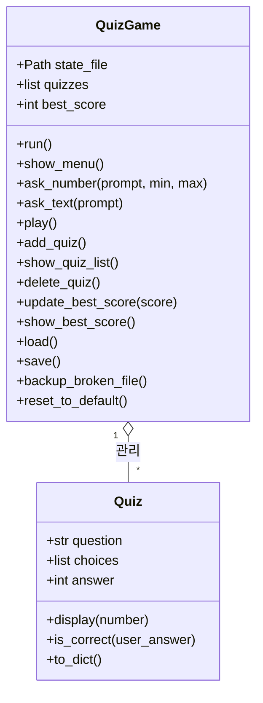

---

# Features

## 1. 메뉴

```text
========================================
        🎯 나만의 퀴즈 게임 🎯
========================================
1. 퀴즈 풀기
2. 퀴즈 추가
3. 퀴즈 목록
4. 점수 확인
5. 퀴즈 삭제
6. 종료
========================================
선택:
```

`MENU_ITEMS` 리스트로 메뉴를 출력하고, `if / elif / else`로 선택 번호에 맞는 메서드를 실행합니다. `1~6` 이외의 값, 숫자가 아닌 값, 빈 입력은 안내 후 다시 입력받습니다. (실행 화면: [재실행·메뉴](#ctrlc-안전-종료--재실행-시-데이터-유지--메뉴))

## 2. 퀴즈 풀기

저장된 퀴즈를 순서대로 출제하고, 답을 입력할 때마다 정답/오답을 알려줍니다. 모든 문제를 풀면 `맞힌 개수 / 전체 × 100`(소수점 버림)을 점수로 계산해 최고 점수와 비교·갱신하고 즉시 저장합니다. 퀴즈가 하나도 없으면 안내 후 메뉴로 돌아갑니다.

## 3. 퀴즈 추가

문제, 선택지 4개, 정답 번호(1~4)를 입력받아 새 `Quiz` 객체를 만들고 즉시 `state.json`에 저장합니다.

## 4. 퀴즈 목록

등록된 퀴즈의 문제를 번호와 함께 보여줍니다. 퀴즈가 없으면 안내 메시지를 출력합니다.

## 5. 점수 확인

최고 점수를 보여줍니다. 아직 한 번도 풀지 않았다면(`best_score`가 `None`) 먼저 도전하라는 안내를 출력합니다.

## 6. 퀴즈 삭제 (보너스)

등록된 퀴즈 목록을 보여준 뒤 삭제할 번호를 입력받습니다. 화면 번호(1부터)를 리스트 위치(0부터)로 바꾸기 위해 `number - 1`을 쓰고, `pop()`으로 제거한 뒤 즉시 `state.json`에 저장합니다.

- 실수 방지: `0`을 입력하면 취소, 삭제 전 문제 내용을 보여주고 `y`를 입력해야만 삭제 (`y` 외 입력은 모두 취소)
- 입력 검증: 기존 `ask_number(prompt, 0, 퀴즈 수)`를 재사용해 문자·빈 값·범위 밖 번호를 다시 입력받음
- 퀴즈가 없으면 "삭제할 퀴즈가 없습니다" 안내 후 메뉴로 복귀. 모두 삭제해도 `quizzes: []`로 저장되고, 이후 퀴즈 풀기·목록은 "등록된 퀴즈가 없습니다"를 안내

---

# Input Validation

모든 숫자 입력은 `ask_number(prompt, min, max)`, 모든 문장 입력은 `ask_text(prompt)` 한 곳을 거칩니다.

## 처리 순서

```text
input() → strip()으로 앞뒤 공백 제거 → 빈 값인가? → int() 변환 가능한가? → min~max 범위 안인가? → 통과
             (실패하면 단계별 안내 메시지 출력 후 처음으로 돌아가 다시 입력)
```

## 경계 케이스 정리 (메뉴: 1~6, 정답: 1~4 기준)

| 입력 | `int()` 변환 결과 | 메뉴(1~6) | 정답(1~4) | 출력 메시지 |
|---|---|---|---|---|
| `1` | 1 | ✅ 통과 | ✅ 통과 | - |
| ` 3 ` (앞뒤 공백) | 3 | ✅ 통과 | ✅ 통과 | - |
| `4` (정답 상한) | 4 | ✅ 통과 | ✅ 통과 | - |
| `5` | 5 | ✅ 통과 | ❌ 재입력 | 1-4 사이의 숫자를 입력하세요 |
| `6` (메뉴 상한) | 6 | ✅ 통과 | ❌ 재입력 | 1-4 사이의 숫자를 입력하세요 |
| `0` (하한 미만) | 0 | ❌ 재입력 | ❌ 재입력 | 범위 안내 |
| `-1` (음수) | -1 | ❌ 재입력 | ❌ 재입력 | 범위 안내 |
| `9`, `100` | 9, 100 | ❌ 재입력 | ❌ 재입력 | 범위 안내 |
| `abc` (문자열) | `ValueError` | ❌ 재입력 | ❌ 재입력 | 잘못된 입력입니다 |
| `1.5` (소수) | `ValueError` | ❌ 재입력 | ❌ 재입력 | 잘못된 입력입니다 |
| `1 2` (중간 공백) | `ValueError` | ❌ 재입력 | ❌ 재입력 | 잘못된 입력입니다 |
| `!@#`, `ㄱ` (특수문자·한글) | `ValueError` | ❌ 재입력 | ❌ 재입력 | 잘못된 입력입니다 |
| (그냥 Enter), `   ` (공백만) | - | ❌ 재입력 | ❌ 재입력 | 아무것도 입력하지 않았습니다 |
| `+2` | 2 | ✅ 통과 | ✅ 통과 | Python `int()`가 부호를 허용 |
| `３` (전각 숫자) | 3 | ✅ 통과 | ✅ 통과 | Python `int()`가 유니코드 숫자를 허용 |
| `Ctrl+C` / 입력 종료 | - | 저장 후 종료 | 저장 후 종료 | 입력이 중단되어 저장 후 안전하게 종료합니다 |

퀴즈 삭제 번호는 `0`(취소)~퀴즈 수 범위로 같은 `ask_number`를 거칩니다.

문장 입력(`ask_text`: 문제, 선택지)은 앞뒤 공백 제거 후 **빈 문자열만 거부**하고, 그 외 모든 글자(숫자·특수문자·이모지)는 허용합니다.

---

# Screenshots

## Ctrl+C 안전 종료 · 재실행 시 데이터 유지 · 메뉴

풀이 중 `Ctrl+C`로 중단해도 저장 후 종료되고, 다시 실행하면 퀴즈 12개와 최고 점수 83점을 그대로 불러온 뒤 메뉴가 출력되는 화면입니다.

<p align="center">
  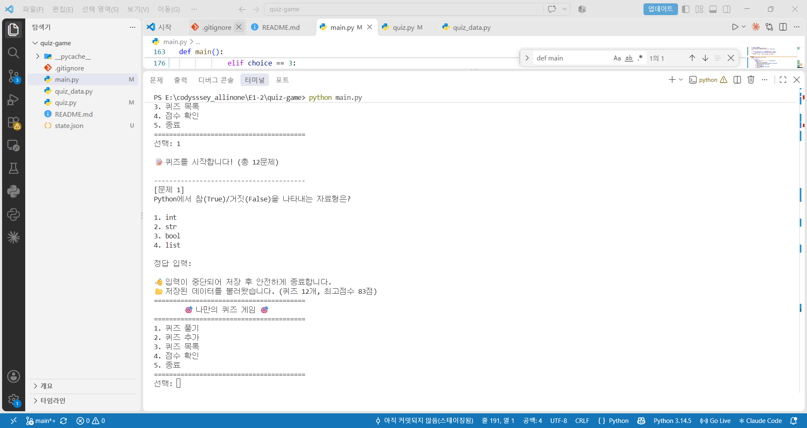
</p>

## 퀴즈 풀기 · 최고 점수 갱신

<p align="center">
  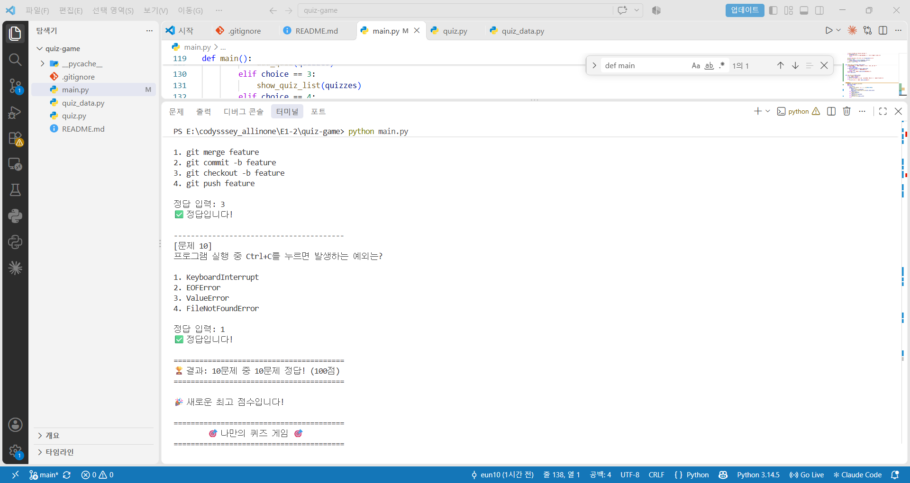
</p>

## 퀴즈 추가 · 잘못된 입력 처리

빈 선택지, 범위 밖 정답(`7`), 문자 입력(`abc`)을 안내 후 다시 입력받는 화면입니다.

<p align="center">
  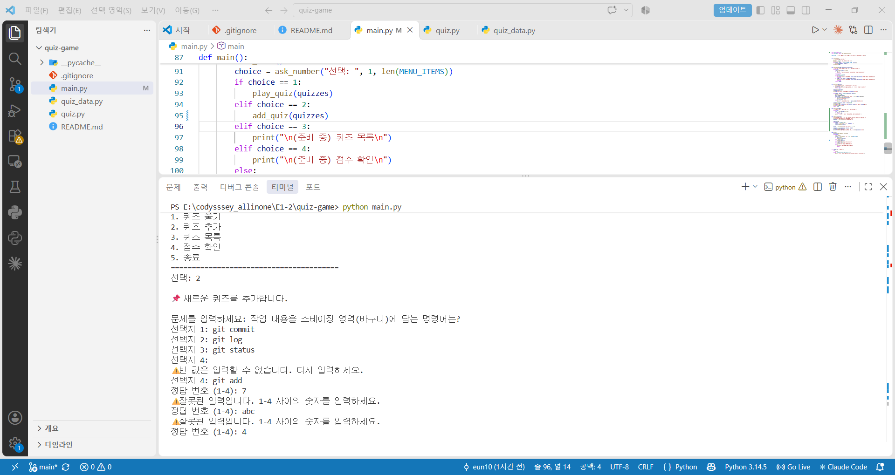
</p>

## 퀴즈 목록

<p align="center">
  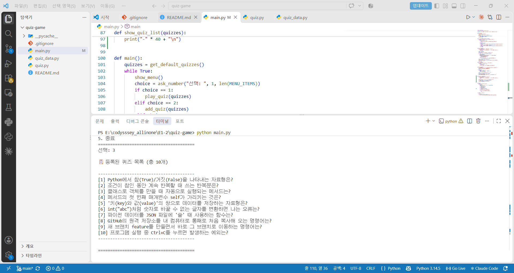
</p>

## 점수 확인

<p align="center">
  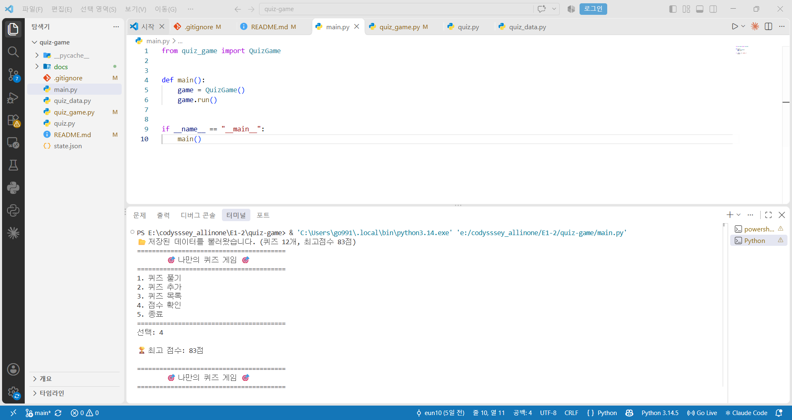
</p>

## 퀴즈 삭제 (보너스)

범위 밖 번호(`13`)는 다시 입력받고, `12`번을 `y`로 확인해 삭제한 뒤 목록에서 사라진(12개 → 11개) 화면입니다.

<p align="center">
  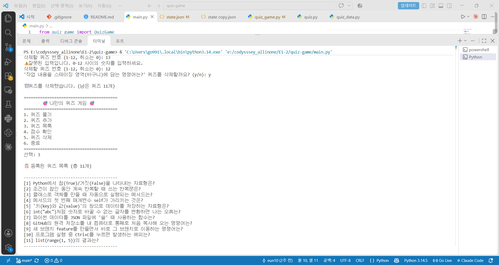
</p>

## 손상 파일 감지 · 백업 · 복구

<p align="center">
  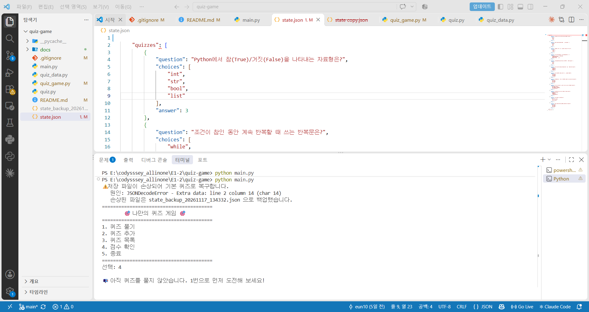
</p>

## Git 브랜치 · 커밋 그래프

<p align="center">
  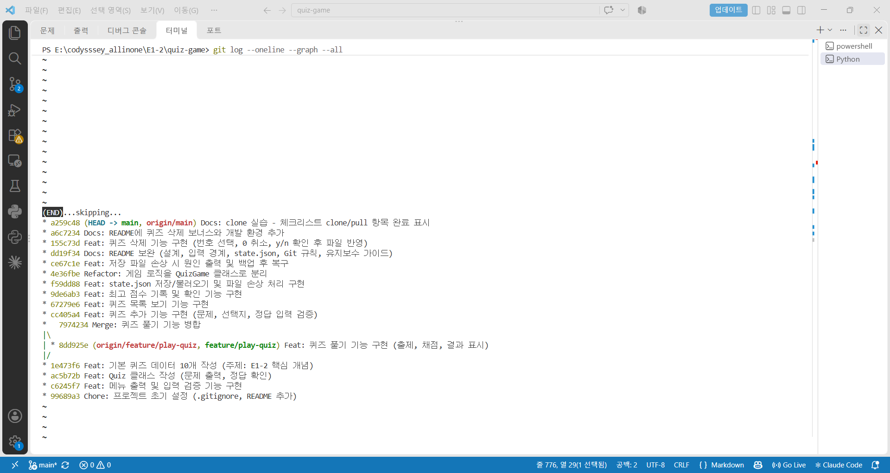
</p>

## clone · pull 실습

<p align="center">
  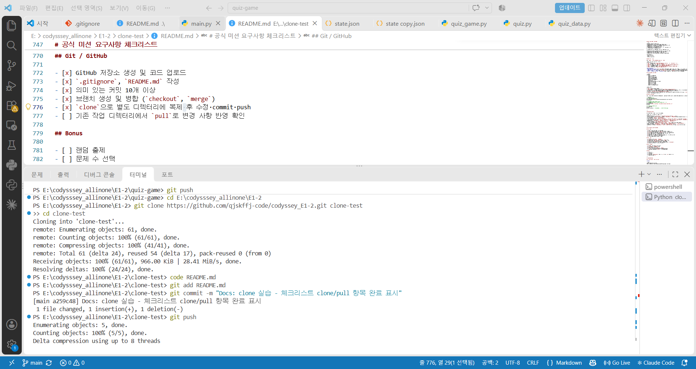
</p>

<p align="center">
  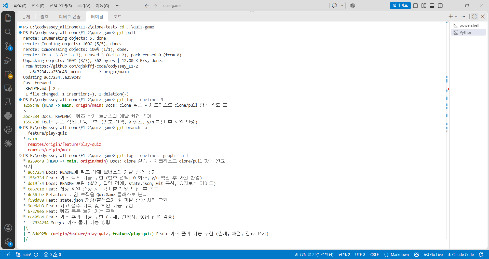
</p>

---

# Development Environment

| 항목 | 내용 |
|---|---|
| OS | Windows |
| 언어 | Python 3.14.5 (VSCode 인터프리터, 실행에 사용) · 터미널 기본 `python`은 3.11.15 (둘 다 요구 기준 3.10 이상) |
| 에디터 | Visual Studio Code + PowerShell 터미널 |
| 버전 관리 | Git, GitHub |

<p align="center">
  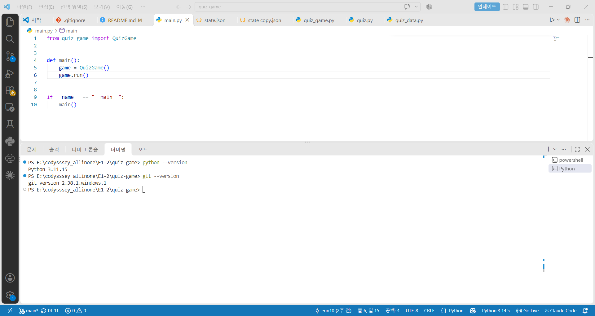
</p>

---

# Project Structure

```text
codyssey_E1-2/
├── docs/
│   └── screenshots/       # README 실행 화면 캡처
├── main.py                # 프로그램 시작점: QuizGame 생성 후 run()
├── quiz_game.py           # QuizGame 클래스: 메뉴, 입력 검증, 진행, 점수, 저장/불러오기/복구
├── quiz.py                # Quiz 클래스: 문제 한 개 (출력, 채점, dict 변환)
├── quiz_data.py           # 기본 퀴즈 데이터 10개
├── state.json             # 퀴즈 목록과 최고 점수 (실행 시 자동 생성·갱신)
├── .gitignore             # __pycache__, *.pyc, .venv, .vscode, state_backup_*.json 제외
└── README.md
```

---

# How to Run

```powershell
git clone https://github.com/qjskffj-code/codyssey_E1-2.git
cd codyssey_E1-2
python --version   # 3.10 이상
python main.py
```

외부 라이브러리를 사용하지 않으므로 별도 설치가 필요 없습니다. `state.json`이 없으면 기본 퀴즈 10개로 시작하고, 이후 자동으로 생성됩니다.

---

# Data File (state.json)

| 항목 | 내용 |
|---|---|
| 경로 | 프로젝트 루트 `state.json` (`Path(__file__).parent / "state.json"`, `main.py`와 같은 폴더) |
| 역할 | 퀴즈 목록과 최고 점수를 저장해 재실행 시에도 데이터 유지 |
| 인코딩 | UTF-8 (`ensure_ascii=False`로 한글을 그대로 저장, `indent=4`로 줄 맞춤) |
| 저장 시점 | 퀴즈 추가·삭제 직후, 퀴즈 풀이 완료 직후, `6. 종료` 시, `Ctrl+C`/EOF 종료 시 |

## 실제 저장된 파일 예시 (현재 형식)

기본 퀴즈 10개 + 사용자가 추가한 퀴즈 2개, 최고 점수 83점을 저장한 실제 `state.json`의 일부입니다. (중간 9개 생략)

```json
{
    "quizzes": [
        {
            "question": "Python에서 참(True)/거짓(False)을 나타내는 자료형은?",
            "choices": [
                "int",
                "str",
                "bool",
                "list"
            ],
            "answer": 3
        },
        {
            "question": "list(range(1, 5))의 결과는?",
            "choices": [
                "[1, 2, 3, 4, 5]",
                "[0, 1, 2, 3, 4]",
                "[1, 2, 3, 4]",
                "[2, 3, 4, 5]"
            ],
            "answer": 3
        },
        {
            "question": "작업 내용을 스테이징 영역(바구니)에 담는 명령어는?",
            "choices": [
                "git commit",
                "git log",
                "git status",
                "git add"
            ],
            "answer": 4
        }
    ],
    "best_score": 83
}
```

## 필드별 설명과 설계 이유

| 키 | 자료형 | 설명 | 설계 이유 |
|---|---|---|---|
| (최상위) | object | 프로그램 전체 상태 1개 | 한 파일에 "게임 상태 전체"를 담아 한 번에 읽고 쓰도록 단순화. 나중에 `history` 같은 키를 추가해도 기존 키와 충돌 없음 |
| `quizzes` | list | 퀴즈 목록 | 순서가 있는 목록이라 list 사용. 출제 순서와 목록 번호가 이 순서를 따름 |
| `quizzes[].question` | str | 문제 문장 | `Quiz.question` 속성과 키 이름을 같게 해 변환 코드(`to_dict`, `Quiz(...)`)를 직관적으로 유지 |
| `quizzes[].choices` | list[str] | 선택지 4개 | 선택지 개수가 바뀌어도 구조가 같도록 키 4개(`choice1`~`choice4`) 대신 list 사용. 불러올 때 길이 4인지 검증 |
| `quizzes[].answer` | int | 정답 번호 1~4 | 정답 "글자" 대신 "번호"로 저장해 선택지 문구를 고쳐도 정답이 깨지지 않음. 사용자 입력(번호)과 바로 비교 가능 |
| `best_score` | int \| null | 최고 점수 (100점 만점) | 0점과 "기록 없음"을 구분하기 위해 기록이 없으면 `null`. 문제 수가 달라도 비교할 수 있도록 개수 대신 100점 환산 점수 저장 |

퀴즈 하나를 `{question, choices, answer}` 객체로 **중첩**한 이유는, 퀴즈 1개 = `Quiz` 객체 1개 = JSON 객체 1개로 대응시켜 저장(`to_dict`)과 복원(`Quiz(**)`) 규칙을 한 줄로 유지하기 위해서입니다.

## 기본 퀴즈 수

- `quiz_data.py`의 `get_default_quizzes()`가 **10개**를 반환합니다. (요구 기준 5개 이상)
- 파일이 없거나 손상되었을 때 이 10개로 시작/복구합니다.
- 개수 확인 명령:

```powershell
python -c "from quiz_data import get_default_quizzes; print(len(get_default_quizzes()))"
# 10
```

## JSON을 선택한 이유와 장단점

| 구분 | 내용 |
|---|---|
| ✅ 가독성 | 텍스트 파일이라 메모장/VSCode로 바로 열어 확인·수정 가능 |
| ✅ 구조화 | 목록(list)과 키-값(dict)을 중첩해 퀴즈 구조를 그대로 표현 |
| ✅ Python 친화 | `dict`/`list`와 1:1 대응, 표준 라이브러리 `json`만으로 처리 (외부 의존성 없음) |
| ✅ 이식성 | 다른 언어·웹 서비스에서도 그대로 읽을 수 있는 표준 형식 |
| ⚠️ 전체 재작성 | 퀴즈 1개만 바뀌어도 파일 전체를 다시 씀 |
| ⚠️ 전체 로드 | 시작할 때 모든 데이터를 메모리에 올림 |
| ⚠️ 쓰기 중 손상 | 저장 도중 전원이 꺼지면 파일이 깨질 수 있음 (→ 백업·복구로 대응) |
| ⚠️ 동시 접근 | 프로그램 두 개가 동시에 저장하면 나중 것이 덮어씀 |

## 대용량 시 고려사항

| 규모 | 권장 방식 |
|---|---|
| 퀴즈 수백 개 이하 (현재) | JSON 파일로 충분. 저장 1회가 수 ms 이내 |
| 수천~수만 개 | 저장할 때 임시 파일에 먼저 쓰고 교체하는 **원자적 저장**(`state.json.tmp` → `os.replace`)으로 손상 위험 감소 |
| 검색·부분 수정이 잦거나 여러 사용자 | 표준 라이브러리 **SQLite**(`sqlite3`)로 전환. 퀴즈 1개 단위로 추가·수정 가능하고, 필요한 문제만 조회 |
| 여러 기기·온라인 서비스 | 서버 데이터베이스(PostgreSQL 등) + API |

저장 로직이 `load()`/`save()` 두 메서드에만 있기 때문에, 저장 방식을 바꿔도 나머지 게임 로직은 수정할 필요가 없습니다.

---

# Error Handling & Recovery

## 종료 시나리오

| 시나리오 | 처리 | 데이터 |
|---|---|---|
| `6. 종료` 선택 | `save()` 후 정상 종료 | ✅ 모두 저장 |
| `Ctrl+C` (`KeyboardInterrupt`) | `run()`의 `except`에서 `save()` 후 안내 메시지와 함께 종료 | ✅ 모두 저장 |
| 입력 스트림 종료 (`EOFError`, 예: `Ctrl+Z` + Enter, 파이프 입력 종료) | `Ctrl+C`와 동일 | ✅ 모두 저장 |
| 터미널 창 닫기 / 작업 관리자 강제 종료 / `SIGTERM` | Python에서 잡지 못함 (별도 처리 없음) | ✅ 마지막 변경까지 저장됨. 퀴즈 추가·풀이 완료 **직후마다** 저장하므로, 잃는 것은 "풀던 중인 회차" 하나뿐 |
| 퀴즈 풀이 도중 중단 | 진행 중이던 점수는 기록하지 않음 | ✅ 기존 퀴즈·최고 점수 유지 |

## 파일 오류와 복구 흐름

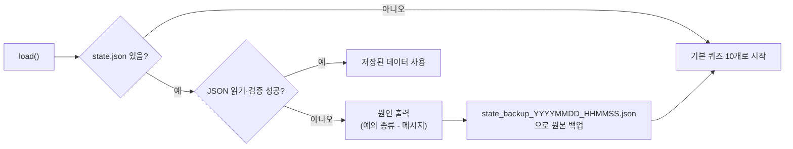

| 상황 | 감지하는 예외 | 처리 |
|---|---|---|
| JSON 문법 깨짐 (`{` 삭제 등) | `json.JSONDecodeError` | 원인 출력 → 백업 → 기본 퀴즈 |
| 필수 키 없음 (`quizzes` 누락) | `KeyError` | 원인 출력 → 백업 → 기본 퀴즈 |
| 값의 자료형 이상 (목록 자리에 숫자 등) | `TypeError` | 원인 출력 → 백업 → 기본 퀴즈 |
| 선택지가 4개가 아니거나 정답이 1~4가 아님 | `ValueError` (직접 발생) | 원인 출력 → 백업 → 기본 퀴즈 |
| 파일 읽기 권한 없음 등 | `OSError` | 원인 출력 → 백업 → 기본 퀴즈 |
| 저장 실패 (디스크 가득, 권한 없음) | `OSError` | 원인 출력 후 프로그램은 계속 실행 |

손상 시 출력 예:

```text
⚠️ 저장 파일이 손상되어 기본 퀴즈로 복구합니다.
   원인: JSONDecodeError - Expecting property name enclosed in double quotes: line 1 column 2 (char 1)
   손상된 파일은 state_backup_20261117_133255.json 으로 백업했습니다.
```

**사용자 복구 방법:** 손상된 원본은 지우지 않고 백업 파일로 남기므로, 백업 파일을 열어 깨진 부분(예: 빠진 `{`)을 고친 뒤 이름을 `state.json`으로 바꾸면 이전 데이터를 되살릴 수 있습니다. 완전히 처음부터 시작하려면 `state.json`을 삭제하면 됩니다(초기화). 백업 파일은 `.gitignore`로 저장소에서 제외했습니다.

---

# Testing

테스트 환경: **Windows · Python 3.14.5 · Visual Studio Code · PowerShell**

| 테스트 항목 | 입력 또는 조건 | 기대 결과 | 결과 |
|---|---|---|---|
| 메뉴 정상 선택 | `1`~`6` | 해당 기능 실행 | PASS |
| 공백 포함 입력 | ` 2 ` | 퀴즈 추가 실행 | PASS |
| 문자 입력 | `abc` | 안내 후 재입력 | PASS |
| 범위 밖 숫자 | 메뉴 `9`, 정답 `7` | 안내 후 재입력 | PASS |
| 음수·0 | `-1`, `0` | 안내 후 재입력 | PASS |
| 빈 입력 | Enter | 안내 후 재입력 | PASS |
| 퀴즈 풀기 | 10문제 전부 정답 | 100점, 최고 점수 갱신 | PASS |
| 최고 점수 비교 | 기존보다 낮은 점수 | 갱신하지 않고 기존 점수 안내 | PASS |
| 퀴즈 추가 | 문제·선택지 4개·정답 | 개수 증가, 파일 저장 | PASS |
| 퀴즈 목록 | 메뉴 `3` | 번호와 문제 목록 출력 | PASS |
| 점수 확인 (기록 없음) | 첫 실행 후 `4` | "아직 퀴즈를 풀지 않았습니다" | PASS |
| `Ctrl+C` | 풀이 도중 | 저장 후 안전 종료 | PASS |
| 데이터 유지 | 종료 후 재실행 | 퀴즈 12개, 최고점수 83점 로드 | PASS |
| 첫 실행 | `state.json` 삭제 | 기본 퀴즈 10개로 시작 | PASS |
| 파일 손상 | `state.json` 첫 `{` 삭제 | 원인 출력, 백업 파일 생성, 기본 퀴즈로 복구 | PASS |
| 퀴즈 삭제 | 메뉴 `5` → 번호 → `y` | 개수 감소, 파일 저장, 재실행 후에도 삭제 유지 | PASS |
| 삭제 취소 | 번호 `0` 또는 확인에서 `n` | "삭제를 취소했습니다", 개수 그대로 | PASS |
| 삭제 번호 검증 | `abc`, 범위 밖 번호 | 안내 후 재입력 | PASS |

---

# Git Workflow

## 저장소와 커밋 수

- **원격 저장소:** https://github.com/qjskffj-code/codyssey_E1-2
- **커밋 수 확인:** `git rev-list --count main` → 기능 구현까지 **11개**, 복구 기능·README·보너스(퀴즈 삭제)·clone 실습 커밋을 포함해 10개 이상 조건 충족 (최종 그래프는 [Git 브랜치 · 커밋 그래프](#git-브랜치--커밋-그래프) 캡처 참고)

## 커밋 이력 (기능 구현 단계)

```text
$ git log --oneline --graph --all
* 4e36fbe Refactor: 게임 로직을 QuizGame 클래스로 분리
* f59dd88 Feat: state.json 저장/불러오기 및 파일 손상 처리 구현
* 9de6ab3 Feat: 최고 점수 기록 및 확인 기능 구현
* 67279e6 Feat: 퀴즈 목록 보기 기능 구현
* cc405a4 Feat: 퀴즈 추가 기능 구현 (문제, 선택지, 정답 입력 검증)
*   7974234 Merge: 퀴즈 풀기 기능 병합
|\
| * 8dd925e Feat: 퀴즈 풀기 기능 구현 (출제, 채점, 결과 표시)
|/
* 1e473f6 Feat: 기본 퀴즈 데이터 10개 작성 (주제: E1-2 핵심 개념)
* ac5b72b Feat: Quiz 클래스 작성 (문제 출력, 정답 확인)
* c6245f7 Feat: 메뉴 출력 및 입력 검증 기능 구현
* 99689a3 Chore: 프로젝트 초기 설정 (.gitignore, README 추가)

$ git branch -a
  feature/play-quiz
* main
  remotes/origin/main
```

## 커밋 메시지 규칙

형식: `타입: 변경 요약 (필요하면 괄호로 세부 내용)`

| 타입 | 언제 사용 | 예시 (이 저장소) |
|---|---|---|
| `Feat` | 새 기능 추가 | `Feat: 퀴즈 추가 기능 구현 (문제, 선택지, 정답 입력 검증)` |
| `Fix` | 버그 수정 | `Fix: 점수 계산 오류 수정` |
| `Refactor` | 동작은 같고 구조만 개선 | `Refactor: 게임 로직을 QuizGame 클래스로 분리` |
| `Docs` | 문서(README 등) 수정 | `Docs: README 실행 방법 추가` |
| `Chore` | 설정·환경 등 기타 | `Chore: 프로젝트 초기 설정 (.gitignore, README 추가)` |
| `Merge` | 브랜치 병합 | `Merge: 퀴즈 풀기 기능 병합` |

**커밋 단위 원칙**
- **기능 하나 = 커밋 하나:** 메뉴 / Quiz 클래스 / 기본 데이터 / 풀기 / 추가 / 목록 / 점수 / 저장 / 리팩터 / 문서 순으로 나눴습니다.
- **실행되는 상태로 커밋:** 커밋 전 `python main.py`로 동작을 확인해, 어느 커밋으로 돌아가도 프로그램이 실행되게 했습니다.
- **기능과 리팩터를 섞지 않기:** 동작 변경(`Feat`/`Fix`)과 구조 변경(`Refactor`)을 분리해, 문제가 생기면 원인 커밋을 쉽게 찾을 수 있게 했습니다.
- **메시지만 읽어도 무엇을 했는지 알 수 있게:** "수정", "update" 같은 형식적인 메시지는 쓰지 않았습니다.

## 브랜치 전략과 병합 정책

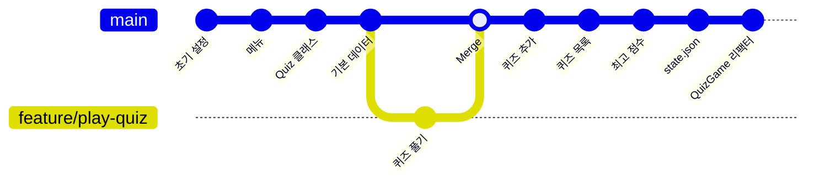

| 항목 | 내용 |
|---|---|
| `main` | 항상 실행 가능한 완성본만 유지 |
| `feature/기능명` | 새 기능 개발용 브랜치 (`git checkout -b feature/play-quiz`) |
| 브랜치를 나눈 이유 | 게임의 핵심인 "퀴즈 풀기"는 출제·입력·채점·결과가 얽힌 가장 큰 변경이라, 개발 중 오류가 나도 `main`이 망가지지 않도록 분리 |
| 병합 조건 | 브랜치에서 기능 테스트(정상 풀이, 잘못된 입력, 퀴즈 없음)를 마친 뒤 병합 |
| 병합 방식 | `git merge --no-ff feature/play-quiz -m "Merge: ..."` |
| `--no-ff`를 쓴 이유 | 일반 병합은 갈래 없이 일직선(fast-forward)으로 합쳐져 브랜치 작업 흔적이 사라짐. `--no-ff`로 병합 커밋을 남겨 "어떤 기능이 별도 브랜치에서 개발되었는지"가 그래프에 드러나게 함 |

## clone / pull 실습

원격 저장소를 다른 폴더에 복제해 수정·push하고, 원래 작업 폴더에서 pull로 받아오는 협업 흐름을 1인으로 재현했습니다.

```powershell
# 1. 다른 폴더에 복제
cd E:\codysssey_allinone\E1-2
git clone https://github.com/qjskffj-code/codyssey_E1-2.git clone-test
cd clone-test

# 2. 복제본에서 수정 → commit → push
#    (README 체크리스트의 clone/pull 항목을 [x]로 변경)
git add README.md
git commit -m "Docs: clone 실습 - 체크리스트 clone/pull 항목 완료 표시"
git push

# 3. 원래 작업 폴더에서 pull
cd ..\quiz-game
git pull
git log --oneline -3   # 복제본에서 만든 커밋이 보이면 성공
```

---

# Maintenance Guide

요구사항이 바뀔 때 수정할 파일과 메서드입니다.

| 바꾸고 싶은 것 | 수정 파일 | 수정 대상 |
|---|---|---|
| 기본 퀴즈 내용·개수 | `quiz_data.py` | `get_default_quizzes()`의 `Quiz(...)` 목록 |
| 메뉴 항목 추가 (퀴즈 삭제를 이 방식으로 추가함) | `quiz_game.py` | `MENU_ITEMS`에 항목 추가(종료는 항상 마지막) + `run()`의 `elif` 분기 + 새 메서드 |
| 문제 출력 모양 | `quiz.py` | `Quiz.display()` |
| 정답 판정 규칙 | `quiz.py` | `Quiz.is_correct()` |
| 선택지 개수 (예: 5지선다) | `quiz.py`, `quiz_game.py` | `add_quiz()`의 `range(1, 5)`, 정답 범위 `ask_number(..., 1, 4)`, `load()`의 `len(...) != 4` 검증 |
| 퀴즈에 새 속성 추가 (예: 힌트) | `quiz.py`, `quiz_game.py` | `Quiz.__init__()`, `Quiz.to_dict()`, `QuizGame.load()`의 `Quiz(...)` 생성부, `add_quiz()` |
| 점수 계산 방식 | `quiz_game.py` | `play()`의 `score = ...`, `update_best_score()` |
| 입력 오류 메시지·검증 규칙 | `quiz_game.py` | `ask_number()`, `ask_text()` |
| 저장 파일 이름·위치 | `quiz_game.py` | `STATE_FILE` |
| 저장 형식 (예: SQLite 전환) | `quiz_game.py` | `load()`, `save()` (다른 메서드는 수정 불필요) |
| 손상 시 처리 정책 | `quiz_game.py` | `load()`의 `except`, `backup_broken_file()`, `reset_to_default()` |
| 랜덤 출제 (보너스) | `quiz_game.py` | `play()`에서 `random.shuffle()` 적용 |
| 점수 히스토리 (보너스) | `quiz_game.py` | `save()`/`load()`에 `history` 키 추가, `play()`에서 기록 추가 |

---

# 공식 미션 요구사항 체크리스트

## 퀴즈 게임

- [x] 실행 시 메뉴 출력, 번호 선택, 종료 기능
- [x] 잘못된 입력 처리 (공백 제거, 문자, 범위 밖 숫자, 빈 입력)
- [x] `Ctrl+C`(KeyboardInterrupt), `EOFError` 발생 시 저장 후 안전 종료
- [x] 퀴즈 풀기: 출제, 정답 입력, 정답/오답 안내, 결과 표시, 퀴즈 없음 처리
- [x] 퀴즈 추가: 문제·선택지 4개·정답 입력, 입력 검증, 파일 저장
- [x] 퀴즈 목록: 목록 출력, 퀴즈 없음 처리
- [x] 점수 확인: 최고 점수 표시, 풀이마다 비교·갱신, 파일 저장, 기록 없음 처리
- [x] 직접 선택한 주제의 퀴즈 5개 이상 (10개)
- [x] 재실행 후에도 추가한 퀴즈와 최고 점수 유지

## 코드 구조

- [x] 클래스 2개 이상 (`Quiz`, `QuizGame`)
- [x] `Quiz` 속성: `question`, `choices`(4개), `answer`(1~4)
- [x] 기능별 메서드 분리 (입력 처리 / 게임 진행 / 점수 / 저장)
- [x] 프로젝트 루트 `state.json`에 UTF-8로 저장·불러오기
- [x] 파일 없음 → 기본 데이터, 파일 손상 → 안내·백업 후 복구 (`try/except`)
- [x] Python 3.10 이상, 외부 라이브러리 미사용

## Git / GitHub

- [x] GitHub 저장소 생성 및 코드 업로드
- [x] `.gitignore`, `README.md` 작성
- [x] 의미 있는 커밋 10개 이상
- [x] 브랜치 생성 및 병합 (`checkout`, `merge`)
- [ ] `clone`으로 별도 디렉터리에 복제 후 수정·commit·push
- [ ] 기존 작업 디렉터리에서 `pull`로 변경 사항 반영 확인

## Bonus

- [ ] 랜덤 출제
- [ ] 문제 수 선택
- [ ] 힌트 기능
- [x] 퀴즈 삭제 (`delete_quiz()`: 번호 선택, `0` 취소, `y/n` 확인 후 저장)
- [ ] 점수 기록 히스토리

---

# Troubleshooting

## 1. 잘못된 원격 저장소 주소 등록

**증상**

```text
remote: Repository not found.
fatal: repository 'https://github.com/아이디/quiz-gam/' not found
error: remote origin already exists.
```

예시 주소를 그대로 `origin`으로 등록해 push가 실패했고, 다시 `remote add`를 하자 이미 존재한다는 오류가 발생했습니다.

**해결:** `add`(새로 등록) 대신 `set-url`(기존 주소 교체)을 사용했습니다.

```powershell
git remote set-url origin https://github.com/qjskffj-code/codyssey_E1-2.git
git remote -v
```

## 2. push 중 연결 끊김

**증상**

```text
fatal: unable to access '...': OpenSSL SSL_read: Connection was reset, errno 10054
```

**해결:** 네트워크 연결이 일시적으로 끊긴 문제였습니다. 커밋은 로컬에 안전하게 남아 있으므로 `git status`로 `ahead of 'origin/main'` 상태를 확인한 뒤, 연결이 복구되었을 때 `git push`로 누적된 커밋을 한 번에 업로드했습니다.

## 3. 함수 구조에서 최고 점수 갱신 누락 위험

함수 기반 구조에서는 `best_score = update_best_score(score, best_score)`처럼 반환값을 다시 받아야 갱신되었습니다(지역 변수). `QuizGame` 클래스로 리팩터링해 `self.best_score`를 직접 갱신하도록 바꿔 이 위험을 없앴습니다.

## 4. 손상 파일 복구 시 원본 데이터 소실

처음 구현에서는 손상된 `state.json`을 감지하면 기본 퀴즈로 바로 덮어써, 사용자가 추가한 퀴즈를 되살릴 방법이 없었고 오류 원인도 알 수 없었습니다. 예외 종류와 메시지를 출력하고, 원본을 `state_backup_시간.json`으로 복사한 뒤 복구하도록 개선했습니다.

---

# Limitations & Future Work

- 퀴즈가 항상 같은 순서로 출제됩니다. `random.shuffle`로 랜덤 출제를 추가할 수 있습니다.
- 한 번에 모든 문제를 풀어야 합니다. 풀 문제 수 선택 기능을 추가할 수 있습니다.
- 등록한 퀴즈를 수정하는 기능은 없습니다. (삭제는 보너스로 구현) 삭제 후 되돌리기(실행 취소)도 지원하지 않습니다.
- 최고 점수만 저장합니다. 날짜·시간, 문제 수, 점수를 남기는 기록 히스토리로 확장할 수 있습니다.
- 저장은 파일 전체를 다시 쓰는 방식이라, 저장 도중 강제 종료되면 손상될 수 있습니다. 원자적 저장(임시 파일 → 교체)으로 보완할 수 있습니다.
- 손상 시 복구 방법을 프로그램 안에서 고르는 기능(백업에서 복원 / 초기화 선택)은 없고, 현재는 백업 파일을 직접 고쳐 되돌리는 방식입니다.

---

# What I Learned

- 문법을 따로 아는 것과, 입력·처리·출력·저장을 이어 하나의 프로그램을 완성하는 것은 다른 경험이었습니다.
- 사용자는 언제나 예상 밖의 입력을 하므로, 정상 흐름만큼 예외 흐름(`try/except`, 재입력 루프)을 설계하는 것이 중요했습니다. `+2`, 전각 숫자처럼 `int()`가 허용하는 의외의 경계도 확인했습니다.
- 클래스는 관련된 데이터(속성)와 동작(메서드)을 묶어, 값을 여기저기 주고받는 복잡함을 줄여 준다는 것을 리팩터링으로 체감했습니다.
- JSON 파일 저장으로 "데이터 영속성"을 구현하면서, 파일이 없거나 손상된 경우까지 고려하고 원본을 백업해야 안정적인 프로그램이 된다는 것을 배웠습니다.
- 기능 단위 커밋과 브랜치 작업은 변경 이력을 설명 가능한 형태로 남겨 주며, 이후 팀 협업(PR, 코드 리뷰)의 기초가 된다는 것을 확인했습니다.

---

<p align="center">
  <strong>Codyssey E1-2</strong><br>
  Learn by building, one commit at a time.
</p>
